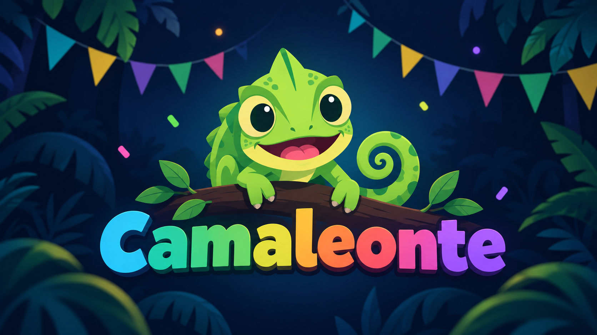

# Camaleonte

**Camaleonte** è un gioco di deduzione sociale gratuito e senza pubblicità, per 3–12 giocatori. È pensato per feste, cene e serate tra amici: basta un solo telefono, da passare di mano in mano, per scoprire chi sta bluffando.

Ogni partecipante riceve un'informazione segreta. Alcuni conoscono la stessa parola, altri devono confondere il gruppo. Attraverso indizi, discussioni e votazioni, i giocatori cercano di individuare gli impostori prima che sia troppo tardi.

**[Gioca sul web](https://falker47.github.io/camaleonte/)** · **[Scarica per Android da Google Play](https://play.google.com/store/apps/details?id=com.falker.camaleonte)**



## Come si gioca

1. **Prepara la partita.** Inserisci i nomi dei giocatori, scegli quanti Camaleonti e Talpe inserire e, se vuoi, attiva i ruoli speciali.
2. **Scopri il tuo segreto.** Ogni giocatore prende il telefono, rivela privatamente la propria carta e lo passa al successivo.
3. **Dai un indizio.** A turno, ciascuno pronuncia una parola o una frase breve legata alla propria parola segreta, cercando di non renderla troppo evidente.
4. **Discutete e votate.** Il gruppo decide chi eliminare. In caso di parità si procede a una nuova votazione e, se necessario, a uno spareggio.
5. **Scoprite il risultato.** La partita continua finché una delle condizioni di vittoria non viene raggiunta. Il gioco calcola i punti e permette di iniziare una nuova manche.

## Ruoli principali

| Ruolo | Cosa sa | Obiettivo |
|---|---|---|
| **Civile** | Conosce la parola principale, condivisa con gli altri Civili. | Individuare ed eliminare tutti gli impostori. |
| **Talpa** | Riceve una parola simile ma diversa, senza sapere di essere un impostore. | Sopravvivere senza destare sospetti. |
| **Camaleonte** | Sa di essere il Camaleonte, ma non riceve alcuna parola. | Inventare indizi credibili e non farsi scoprire. |

Se viene eliminato, il Camaleonte ha **60 secondi per indovinare la parola dei Civili**. Una risposta corretta gli permette di ottenere punti anche dopo l'eliminazione.

### Condizioni di vittoria

I Civili vincono quando tutti i Camaleonti e le Talpe sono stati eliminati.

Gli impostori possono invece vincere sopravvivendo fino a una soglia che dipende dal numero iniziale di partecipanti:

| Giocatori iniziali | Soglia di sopravvivenza |
|---|---|
| 3–5 | 2 giocatori rimasti |
| 6–8 | 3 giocatori rimasti |
| 9–12 | 4 giocatori rimasti |

Quando il numero dei giocatori ancora in partita raggiunge la soglia, gli impostori sopravvissuti vincono la manche. Non è quindi sufficiente che siano semplicemente più numerosi dei Civili.

I punti dipendono dal ruolo, dall'esito della manche e da eventuali abilità speciali. Le regole di punteggio complete sono consultabili direttamente nel gioco.

## Ruoli speciali

Puoi attivare sei ruoli opzionali per rendere le partite più imprevedibili.

| Ruolo | Min. giocatori | Abilità |
|---|---:|---|
| **Buffone** | 5 | Guadagna 2 punti bonus se viene eliminato al primo turno. |
| **L'Eterno** | 3 | Continua a votare dopo l'eliminazione e decide chi eliminare in caso di parità. |
| **Duellanti** | 4 | Due giocatori diventano rivali: il primo eliminato perde un punto, che passa all'altro. |
| **Romeo & Giulietta** | 5 | Se uno dei due viene eliminato, viene eliminato anche l'altro. |
| **Riccio** | 5 | Quando viene eliminato, può trascinare con sé un altro giocatore. |
| **Oracolo** | 4 | Quando viene eliminato, può rivelare il ruolo di un altro giocatore. |

I ruoli speciali si aggiungono ai ruoli principali e non richiedono altri dispositivi.

## Parole, durata e salvataggi

Il gioco contiene **507 set di parole suddivisi in 16 categorie**, tra cui Cinema, Scienza, Sport, Fantasy e Tecnologia. Molti set comprendono una terza parola, utilizzata nelle configurazioni con più Talpe.

Puoi scegliere una durata di **1, 2 o 3 giri**, oppure giocare senza limite. Ogni giro comprende una manche per ciascun partecipante: per esempio, con 5 giocatori e 2 giri si disputano 10 manche.

Al termine di ogni manche, i punti vengono aggiunti alla classifica. Nelle partite a durata definita, il gioco presenta una classifica finale quando tutte le manche sono state completate.

La partita in corso viene salvata sul dispositivo e può essere ripresa successivamente. Il salvataggio comprende anche l'avanzamento, i ruoli e i punteggi.

È inoltre possibile ricominciare una manche annullandola, senza consumare una delle manche previste.

## Versioni disponibili

- **Web/PWA:** giocabile dal browser e installabile come applicazione sui dispositivi compatibili. Dopo il primo caricamento, le risorse necessarie sono progettate per essere disponibili anche offline.
- **Android:** applicazione disponibile su Google Play, realizzata tramite Capacitor a partire dal progetto web.

Non sono necessari account o dispositivi aggiuntivi. Una volta disponibili le risorse dell'applicazione, si può giocare senza connessione Internet.

## Architettura

Il progetto utilizza:

- **React 19 e TypeScript** per l'interfaccia e la logica applicativa;
- **Zustand** per gestire lo stato della partita;
- **Tailwind CSS v4 e Framer Motion** per lo stile mobile-first e le animazioni;
- **Vite 5 e vite-plugin-pwa** per la build web e il supporto offline;
- **Capacitor 8** per l'applicazione Android;
- **GitHub Pages** per distribuire la versione web.

Le regole di gioco sono organizzate in `src/utils/`, mentre `src/store/gameStore.ts` gestisce turni, votazioni, eliminazioni, abilità, punteggi e rivincite. Le parole si trovano in `src/data/wordPairs.ts` e le schermate in `src/screens/`.

## Sviluppo locale

È richiesto **Node.js 22 o successivo**.

Per installare le dipendenze e avviare il progetto:

```bash id="5zzhbb"
npm ci
npm run dev
```

Per eseguire i test e generare la build web:

```bash id="g6ytq7"
npm run test:core
npm run build
```

Per sincronizzare le risorse web con il progetto Android:

```bash id="zyh84y"
npm run build:android
```

Quest'ultimo comando prepara il progetto Capacitor, ma **non pubblica l'applicazione su Google Play** e non genera automaticamente una release firmata. Per compilare pacchetti Android sono necessari gli strumenti Android, incluso JDK 21 e l'Android SDK; la distribuzione richiede inoltre la configurazione della firma.

### Test e distribuzione

Il workflow GitHub Actions esegue automaticamente i test core e la build sulle pull request dirette a `master` e sui push al branch.

I test coprono, tra gli altri aspetti, le condizioni di vittoria, la durata delle sessioni, il salvataggio delle partite e la gestione delle risorse Android.

Le pull request prevedono anche verifiche di compilazione e packaging Android. Dopo un push su `master`, se i controlli hanno esito positivo, il workflow distribuisce la versione web su GitHub Pages.

## Privacy

Camaleonte non richiede registrazione, non utilizza un backend per le partite e non include pubblicità o sistemi di tracciamento.

I dati di gioco e i salvataggi rimangono sul dispositivo, senza sincronizzazione fra dispositivi. L'abbandono di una partita salvata ne elimina i dati locali.

È presente soltanto un collegamento facoltativo a PayPal per chi desidera sostenere lo sviluppo: aprirlo comporta l'accesso a un servizio esterno.

Per maggiori informazioni, consulta la [Privacy Policy](public/privacy.html).

## Licenza e autore

© 2026 [falker47](https://github.com/falker47). **Tutti i diritti riservati.**

Il codice sorgente è pubblico ma proprietario: la sua disponibilità su GitHub non concede automaticamente diritti di copia, modifica o redistribuzione. Consulta il file [LICENSE](LICENSE) per i termini completi.
